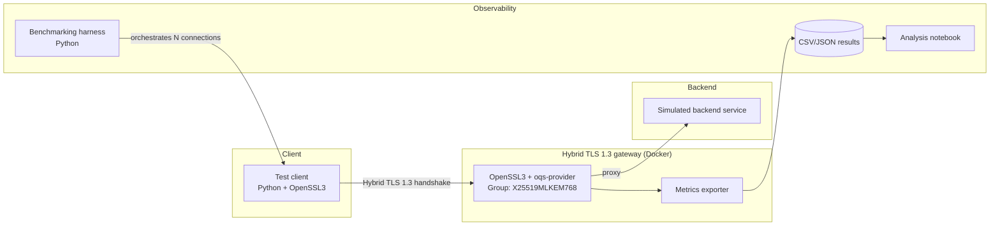

# PQC-Gateway

[](https://github.com/acostacrypto/pqc-gateway/actions/workflows/ci.yml)
[](https://github.com/acostacrypto/pqc-gateway/actions/workflows/security.yml)
[](LICENSE)
[](docs/architecture.md)

**Hybrid classical post-quantum TLS 1.3 gateway** (group `X25519MLKEM768`)
with **reproducible benchmarking** of the handshake overhead and an
end-to-end **DevSecOps** pipeline: SBOM, artifact signing, vulnerability and
secret scanning.

> **Status: experimental prototype / research.**
> `liboqs` and `oqs-provider` are **experimental**, as stated by the Open
> Quantum Safe project itself. This project **does not implement its own
> cryptography**, **is not audited** and **must not be used in production**.
> Nothing here should be described as "quantum-proof": these are mechanisms
> designed under current post-quantum hardness assumptions, with no guarantee
> that they will hold in the future.

---

## 1. Why this project exists

Organisations need to understand **how to migrate TLS to hybrid schemes
without breaking compatibility**, and there is little *practical, measurable*
(not just theoretical) evidence of what that change implies for performance
and operations.

**Research question:**

> What is the latency and handshake-size overhead of adopting hybrid TLS
> `X25519 + ML-KEM-768` over classical ECDHE, under controlled local network
> conditions?

The answer comes from a documented experimental design
(`docs/methodology.md`): ≥30 repetitions per combination, discarded
*warm-up* runs, classical and PQC-only baselines, and **median and IQR**
reporting — never the mean alone. Concrete figures are marked as
`[pending measurement]` until generated experimentally.

**Why hybrid instead of pure PQC:** the combination is an "AND": compromising
the session requires breaking *both* components (X25519 and ML-KEM). While PQC
schemes have not accumulated the same cryptanalysis history as classical
cryptography, the classical component guarantees the session is at least as
strong as ECDHE.

---

## 2. Architecture



| Component | Role | Language |
|---|---|---|
| `docker/Dockerfile.gateway` | Multi-stage image: builds OpenSSL 3 + `liboqs` + `oqs-provider` from source, with a *smoke test* at build time | Dockerfile/C |
| `docker/Dockerfile.client` | Test client: inherits the PQC base image and adds the Python harness | Dockerfile/Python |
| `docker/docker-compose.yml` | Orchestrates gateway + client on an internal Docker network | YAML |
| `src/python/pqc_gateway` | Orchestration and benchmarking harness (median/IQR, CSV) | Python |
| `src/cpp` | Optional utilities: a pure C++ client to measure overhead without the Python interpreter | C++ |
| `benchmarks/scripts` + `notebooks` | Repetitions, metric collection and analysis | Python/Jupyter |

**Trust boundaries:** the client and the simulated attacker are *outside*; the
gateway and the simulated backend are *inside*, on an isolated internal Docker
network. Demo certificates are generated at build time and are **never**
committed.

---

## 3. Quick start

Requirements: Docker with Compose v2 and `git`.

```bash
git clone https://github.com/acostacrypto/pqc-gateway.git
cd pqc-gateway

# 1) PQC base image (OpenSSL 3 + liboqs + oqs-provider, built from source)
docker build -f docker/Dockerfile.gateway -t pqc-gateway:base .

# 2) Full stack (gateway on standby + test client, internal network)
docker compose -f docker/docker-compose.yml up --build

# 3) Verify the PQC provider is loaded
docker compose -f docker/docker-compose.yml exec gateway openssl list -providers

# 4) Verify the available hybrid groups (should include X25519MLKEM768)
docker compose -f docker/docker-compose.yml exec gateway \
  openssl list -tls-groups -tls1_3
```

Run the harness locally (without Docker):

```bash
python -m pip install -e ".[dev]"
pytest                                   # unit tests
ruff check .                             # static analysis
PYTHONPATH=src/python python -m pqc_gateway.cli --help
```

> The harness `bench` command is not implemented yet: it raises an explicit
> `NotImplementedError` (see `docs/methodology.md`).

---

## 4. Repository structure

```
pqc-gateway/
├── README.md                  # manual — this file
├── LICENSE                    # manual — MIT
├── CITATION.cff               # manual — academic citation (Zenodo)
├── SECURITY.md                # manual — vulnerability reporting policy
├── CONTRIBUTING.md            # manual
├── pyproject.toml             # harness tooling (pytest/ruff/bandit)
├── .gitignore                 # Python / C / C++ / Docker / secrets / CI
├── docs/
│   ├── architecture.md        # manual — includes Mermaid diagrams
│   ├── methodology.md         # manual — experimental methodology
│   └── adr/                   # manual — Architecture Decision Records
├── src/
│   ├── python/                # manual — harness and orchestration
│   └── cpp/                   # manual — utilities/bindings if applicable
├── docker/
│   ├── Dockerfile.gateway     # manual — multi-stage PQC base image
│   ├── Dockerfile.client      # manual — test client
│   └── docker-compose.yml     # manual
├── tests/
│   ├── unit/                  # manual
│   └── integration/           # manual — end-to-end handshake in CI
├── benchmarks/
│   ├── scripts/               # manual
│   └── results/               # AUTOGENERATED (only relevant snapshots versioned)
├── notebooks/                 # manual (code); heavy outputs not versioned
├── .github/workflows/         # manual — ci.yml, security.yml, release.yml
├── sbom/                      # AUTOGENERATED in CI (Syft), published as artifact
├── security-reports/          # AUTOGENERATED in CI (Trivy, Bandit, …)
└── data/                      # small datasets; large ones via Zenodo/Git LFS
```

**General rule:** everything a human reasons about (code, tests, docs,
decisions) is versioned; everything that is a deterministic *output* of a tool
(SBOM, scan reports, raw benchmarking results per run) is generated in CI and
published as an artifact or release asset, to keep the commit history clean.

---

## 5. DevSecOps pipeline

| Workflow | Controls | Trigger |
|---|---|---|
| [`ci.yml`](.github/workflows/ci.yml) | `ruff` (Python lint), `cppcheck` (if C/C++ exists), `pytest` (unit + integration), **Docker image build** with cache, provider *smoke test*, **Trivy** on the image and **Syft SBOM** published as an artifact | push/PR to `main` |
| [`security.yml`](.github/workflows/security.yml) | **Gitleaks** (secrets), **bandit** (Python static), **pip-audit** (dependencies), **Trivy fs** (dependencies and misconfigurations) | push/PR to `main` + weekly |
| [`release.yml`](.github/workflows/release.yml) | Build + publish to GHCR, SBOM, **keyless signing with cosign** (GitHub Actions OIDC) and GitHub Release with version notes | tag `vX.Y.Z` |

In addition:

- **`main` branch protection:** every change goes through a Pull Request with
  **1 required approval**; no *force-push*, no branch deletion (see §7).
- **Manual semantic versioning** with `vX.Y.Z` tags and release notes.
- **Documentation** planned with MkDocs + Material published on GitHub Pages.
- Honest limitations: Trivy/Syft do not replace a professional audit; Gitleaks
  only detects known patterns; keyless cosign depends on Fulcio/Rekor
  availability (local-key signing is the alternative).

---

## 6. Security and limitations

Read [`SECURITY.md`](SECURITY.md) and `docs/architecture.md` before using or
citing any result. Summary:

- Risk of implementations not audited to the level of mature TLS libraries.
- **Downgrade** risk if the configuration silently accepts classical groups
  (explicitly studied by the crypto-agility module).
- Simplified demo key custody (no HSM): not representative of a production
  environment.
- IETF hybrid group identifiers keep evolving: the project **pins and
  documents** the exact versions used.
- Supply-chain risk in `liboqs`/OpenSSL (mitigated with continuous scanning,
  not eliminated).

---

## 7. Branches and review

The **`main` branch is protected** on GitHub:

- changes land **only through a Pull Request**;
- **at least 1 approval** is required (with *dismiss stale reviews*);
- no *force-push*, no branch deletion.

Sensitive paths (`docker/`, TLS configuration and the security workflows)
require mandatory review as described in `CONTRIBUTING.md`.

---

## 8. Citing this project

```bibtex
@software{pqc_gateway_2026,
  author  = {Acosta Fonseca, Frank Ernesto},
  title   = {PQC-Gateway: hybrid classical post-quantum TLS 1.3 gateway with benchmarking and DevSecOps},
  year    = {2026},
  url     = {https://github.com/acostacrypto/pqc-gateway},
  version = {0.1.0}
}
```

Full metadata in [`CITATION.cff`](CITATION.cff).

## 9. License

[MIT](LICENSE) — © 2026 Frank Ernesto Acosta Fonseca.

Third-party dependencies keep their own licenses (OpenSSL: Apache-2.0;
`liboqs`: MIT; `oqs-provider`: permissive — **verify in their repositories**
before relying on them).
