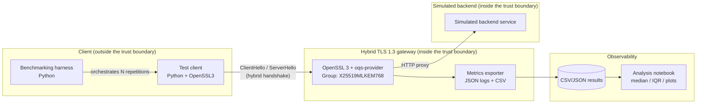

# PQC-Gateway architecture

> Living document. Contains Mermaid diagrams, trust boundaries and
> implementation decisions. Non-trivial decisions are recorded in [`adr/`](adr/).

## 1. Goal

Expose a **TLS 1.3 gateway** negotiating the `X25519MLKEM768` hybrid group
(X25519 + ML-KEM-768) and measure, reproducibly, the overhead of that
handshake against a classical baseline (ECDHE).

No TLS or cryptographic primitive of our own is implemented: everything comes
from OpenSSL 3 + `liboqs` + `oqs-provider`.

## 2. Flow diagram

## 3. Components

| Component | Description | Current implementation |
|---|---|---|
| PQC base image | Builds OpenSSL 3 + `liboqs` + `oqs-provider` from source in a *builder* stage; the *runtime* stage copies only the installed tree (~400 MB smaller) and runs a build-time *smoke test* of the provider | `docker/Dockerfile.gateway` |
| Gateway | Runs the TLS server with the hybrid group and exports handshake metrics | `docker/docker-compose.yml` (`gateway` service); server to be completed in week 2 |
| Test client | Inherits the PQC base image and adds the Python harness to orchestrate connections | `docker/Dockerfile.client` |
| Harness | Repetitions, *warm-up* control, time/byte collection and CSV writing | `src/python/pqc_gateway` |
| Simulated backend | Proxy target (synthetic responses, no real data) | internal Docker network |
| Analysis | Median, IQR, plots and combination comparison | `notebooks/` |

## 4. Docker images

### 4.1 `docker/Dockerfile.gateway` (base image, multi-stage)

- **`builder` stage:**
  1. OpenSSL `3.5.5` (pinned via `ARG OPENSSL_VERSION`) built with
     `--prefix=/opt/ossl`.
  2. `liboqs` built against that OpenSSL (`BUILD_SHARED_LIBS=ON`, tests
     disabled).
  3. `oqs-provider` built and copied to a fixed path
     (`/opt/ossl/lib/ossl-modules/oqsprovider.so`).
  4. A deterministic `openssl.cnf` that **explicitly** activates both the
     `default` *and* `oqsprovider` providers (in OpenSSL 3, if only another
     provider is explicitly activated, `default` stops auto-loading and every
     key operation fails).
  5. Build-time *smoke test*: `openssl list -providers`, ML-KEM-768 key
     generation, ML-DSA-65 sign/verify. **The build fails if any step fails.**
- **`runtime` stage:** minimal Ubuntu 24.04 + `ca-certificates`, copy of
  `/opt/ossl`, symlink to the distro CA certificates and final re-verification.

### 4.2 `docker/Dockerfile.client`

Inherits from the base image (`ARG BASE_IMAGE=pqc-gateway:base`), adds Python 3
and copies `src/python`. No PyPI dependencies are installed: the MVP harness is
standard library only.

### 4.3 Network and ports

- Internal network `pqc-net`: gateway and client only talk to each other; the
  backend exposes no ports to the host.
- `4433/tcp` reserved for the gateway TLS server (published to the host for
  local testing; recommended not to expose it outside Docker).

## 5. Trust boundaries and attack surface

| Element | Inside the trust boundary | Notes |
|---|---|---|
| Gateway (OpenSSL + oqs-provider) | Yes | Runs on an isolated network |
| Simulated backend | Yes | No real data |
| Test client / harness | **No** | May be hostile in the threat model |
| Simulated attacker (crypto-agility module) | **No** | Own, isolated infrastructure only |

Relevant attack surface:

1. TLS/PQC implementation (bugs in `liboqs`/`oqs-provider`).
2. Cipher suite and group configuration (*downgrade* risk).
3. Docker image (vulnerable base-image dependencies).
4. Logs with possible metadata leakage.
5. CI artifacts (SBOM, signatures) tampering.

## 6. Key and secret management

- **Session keys:** ephemeral, part of the TLS 1.3 protocol.
- **Demo certificates:** self-signed, generated at build/start-up time and
  blocked by `.gitignore` (`*.pem`, `*.key`, `certs/`). **Never** committed.
- **Artifact signing:** keyless with cosign via GitHub Actions OIDC; no
  persistent private key to custody. If signing ever moves to a classical key,
  that key lives in GitHub Encrypted Secrets.
- **Production:** out of scope — no HSM, no automated rotation, no access
  policies. A documented limitation, not a hidden one.

## 7. Logging and metrics

- Structured (JSON) gateway logs.
- Handshake metrics (time in ms, total bytes, CPU usage, success rate, jitter)
  exported to CSV in `benchmarks/results/` (not versioned; published as a CI
  artifact).
- Analysis in `notebooks/` using median and IQR (not the mean alone).

## 8. Architecture decisions

| ADR | Decision | Status |
|---|---|---|
| [ADR-0001](adr/ADR-0001-liboqs-oqs-provider.md) | Use `liboqs` + `oqs-provider` on OpenSSL 3 as the hybrid TLS stack | Accepted |

## 9. Traceability with the plan

| Item | Plan week |
|---|---|
| Reproducible `Dockerfile.gateway` | 1 |
| Hybrid handshake server↔client | 2 |
| Benchmarking harness v1 | 3 |
| Basic CI | 4 |
| End-to-end `docker-compose` | 5 |
| Multiple groups compared | 6 |
| Static analysis + dependencies | 7 |
| SBOM + Trivy + Gitleaks | 8 |
| cosign + documentation | 9 |
| Release + demo | 10 |
